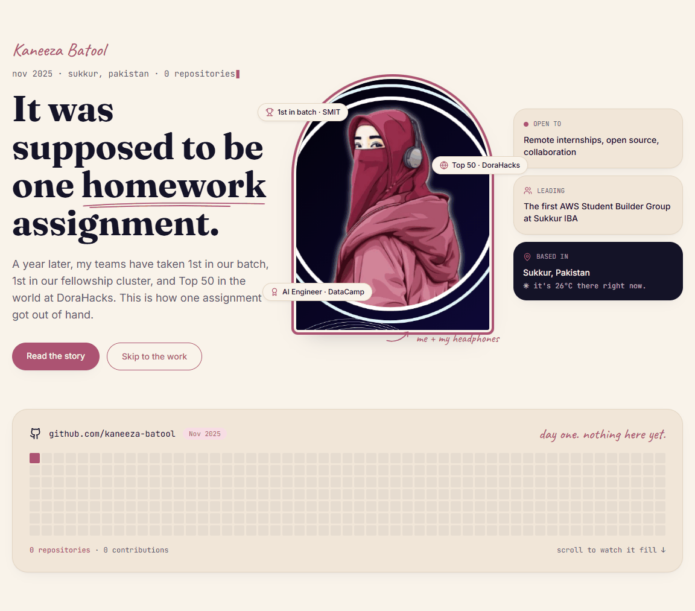
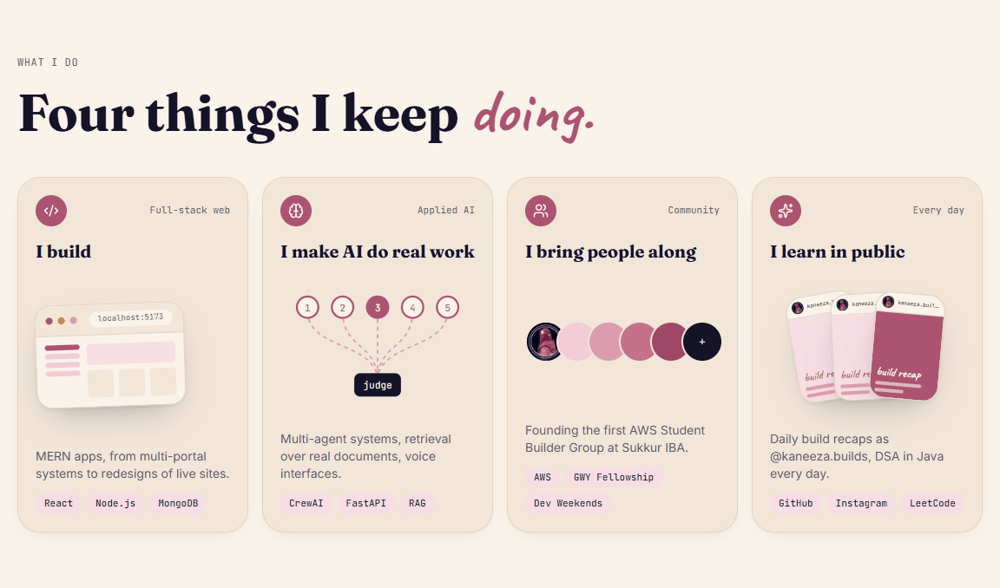
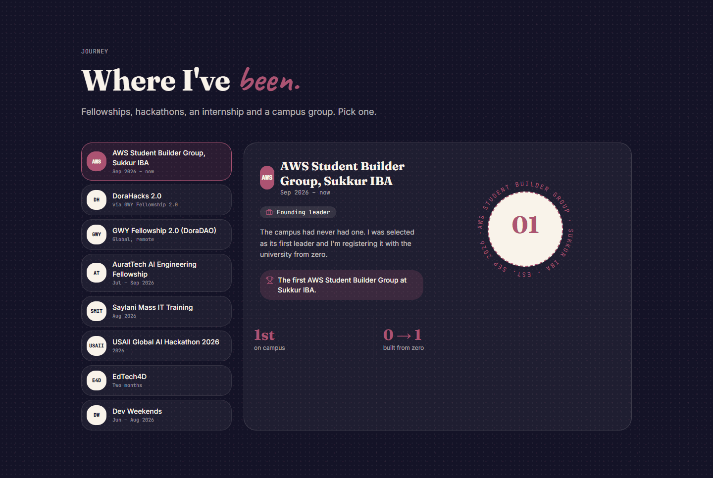
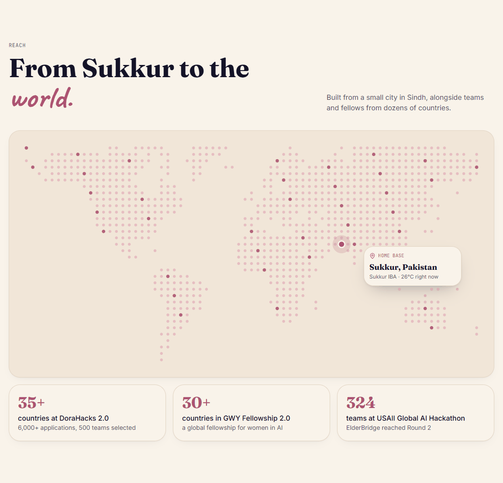
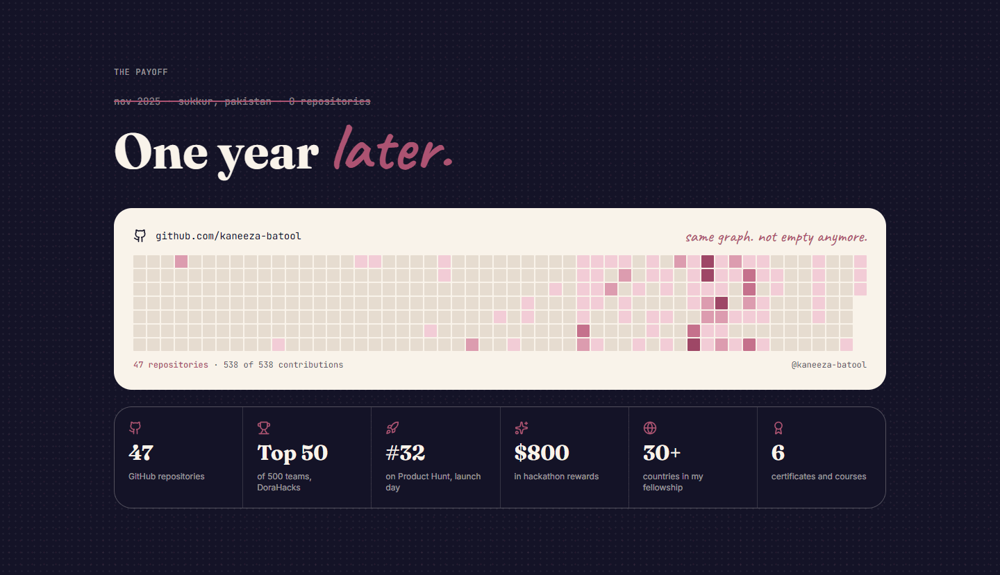
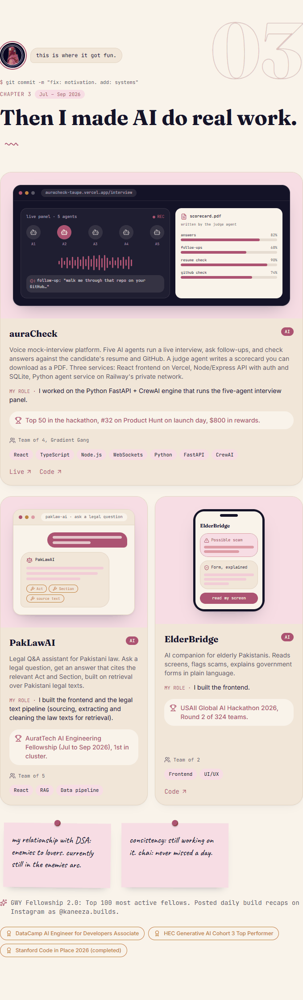
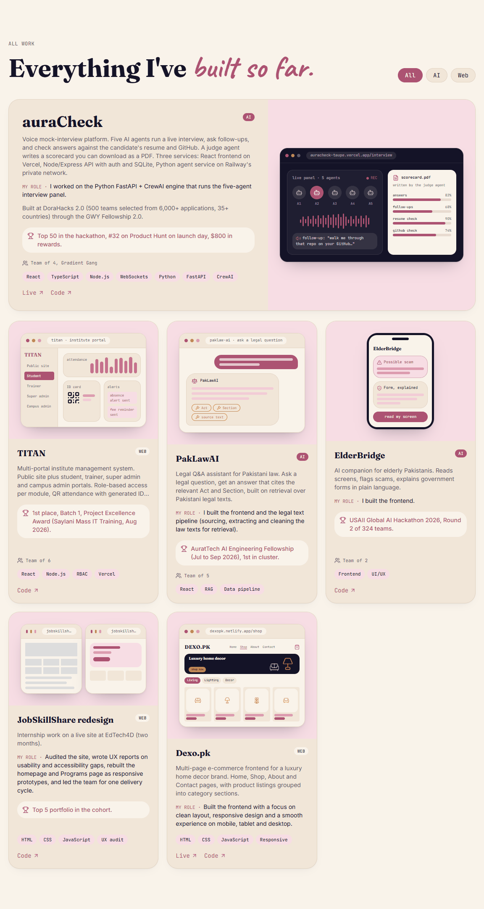
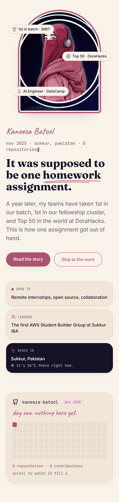
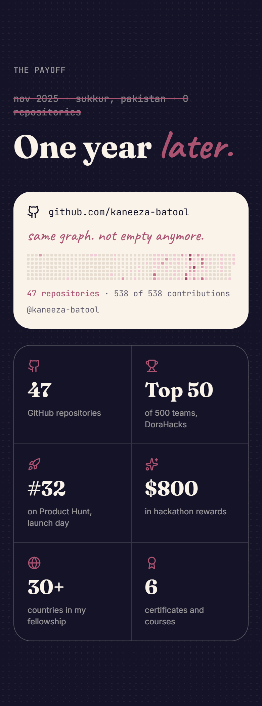
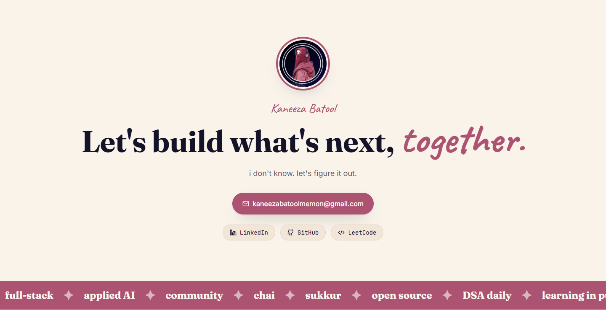

<div align="center">

# Kaneeza Batool · Portfolio

**A scroll-driven story portfolio: from an empty GitHub profile to a year of shipped projects.**

Full-stack (MERN) developer moving into applied AI · CS student at Sukkur IBA, Pakistan

[](https://react.dev)
[](https://tanstack.com/start)
[](https://www.typescriptlang.org)
[](https://tailwindcss.com)
[](https://vite.dev)
[](https://kaneeza-batool-portfolio.vercel.app/)

### [🌐 kaneeza-batool-portfolio.vercel.app](https://kaneeza-batool-portfolio.vercel.app/)

[LinkedIn](https://www.linkedin.com/in/kaneeza-batool) · [GitHub](https://github.com/kaneeza-batool) · [LeetCode](https://leetcode.com/u/kaneezabatool) · [Email](mailto:kaneezabatoolmemon@gmail.com)



</div>

---

## The idea

Most portfolios open with their best numbers. This one opens with **zero**.

The hero shows an empty GitHub contribution graph from November 2025. As you scroll through four chapters, the same graph fills in, chapter by chapter. The page ends with a **"One year later"** section that shows the full graph and the stats. The story moves from homework, to shipping, to applied AI, to building a community, and the numbers only appear once they've been earned.

## Screenshots

<table>
  <tr>
    <td width="50%"><br /><sub><b>What I do</b>: four cards, each with its own illustration</sub></td>
    <td width="50%"><br /><sub><b>Journey</b>: click through fellowships, hackathons and an internship</sub></td>
  </tr>
  <tr>
    <td width="50%"><br /><sub><b>Reach</b>: dotted world map with a live pin on Sukkur</sub></td>
    <td width="50%"><br /><sub><b>The payoff</b>: the same graph, filled, with live GitHub numbers</sub></td>
  </tr>
  <tr>
    <td width="50%"><br /><sub><b>The story</b>: chapters with project cards and screen mockups</sub></td>
    <td width="50%"><br /><sub><b>All work</b>: filter projects by All, AI or Web</sub></td>
  </tr>
</table>

<p align="center">
  
  &nbsp;&nbsp;
  
  <br /><sub>Fully responsive. The hero and payoff sections on a 390px phone screen.</sub>
</p>

<p align="center">
  
</p>

## Features

- **Scroll-driven storytelling.** The contribution graph fills in as each chapter scrolls into view: a sticky sidebar on desktop, a sticky bar on mobile.
- **Live data, no backend.**
  - Contribution history from the [GitHub Contributions API](https://github-contributions-api.jogruber.de).
  - Public repository count from the [GitHub REST API](https://docs.github.com/en/rest/users/users#get-a-user).
  - Current temperature in Sukkur from [Open-Meteo](https://open-meteo.com).
  - Each one falls back gracefully if its request fails.
- **Illustrated project screens.** Each project card shows a hand-built UI mockup made with React and Tailwind (agents and scorecard for auraCheck, portals and QR ID card for TITAN, and so on). They're code, not images, so they stay sharp at any size.
- **Generated world map.** The dotted map was generated once with [`dotted-map`](https://www.npmjs.com/package/dotted-map) and embedded as about 600 bytes of hex. The library isn't shipped to visitors.
- **Small details.** Sticky notes, polaroids, a corkboard, keyboard-key tool chips, a rotating stamp, a letter to my future self, and a hidden easter egg (click the avatar near the bottom of the page three times).
- **Accessible motion.** Every animation turns off under `prefers-reduced-motion`. The page uses semantic HTML, alt text and keyboard-reachable controls throughout.
- **Server-side rendering** with TanStack Start, deployed on Vercel.

## Tech stack

| Layer | Tools |
| --- | --- |
| Framework | React 19, TanStack Start (SSR) and TanStack Router (file-based routes) |
| Language | TypeScript (strict mode) |
| Styling | Tailwind CSS 4, Lightning CSS, custom design tokens in `oklch` |
| Typography | Fraunces (display), Inter (body), JetBrains Mono (code), Caveat (handwriting) |
| Icons | lucide-react |
| Build | Vite 8 |
| Hosting | Vercel, built through Nitro (which also supports other hosts through presets) |
| Quality | ESLint, Prettier, Vitest and Testing Library |

## Getting started

**Prerequisites:** Node.js 20+ and npm.

```sh
git clone https://github.com/kaneeza-batool/portfolio.git
cd portfolio
npm install
npm run dev        # http://localhost:8080
```

### Scripts

| Command | What it does |
| --- | --- |
| `npm run dev` | Starts the dev server with hot reload on port 8080 |
| `npm run build` | Production build in `.output/` (targets Vercel when built on Vercel) |
| `npm run test` | Runs the test suite once with Vitest |
| `npm run lint` | Lints the project with ESLint |
| `npm run format` | Formats the codebase with Prettier |

## Deployment

The site is live at **[kaneeza-batool-portfolio.vercel.app](https://kaneeza-batool-portfolio.vercel.app/)** and deploys automatically from this repository on Vercel:

- **Every push to `main`** triggers a production deployment.
- **Pull requests** get their own preview URL.
- **No `vercel.json` is needed.** Nitro detects the Vercel build environment and outputs the right format, and Vercel's default settings (`npm install`, `npm run build`) work as they are.

To deploy your own copy, import the repo at [vercel.com/new](https://vercel.com/new) and keep the defaults.

To deploy somewhere else instead, set a [Nitro preset](https://nitro.build/deploy) when you build:

```sh
NITRO_PRESET=netlify npm run build      # or cloudflare-module, node-server, ...
```

To test a production build locally:

```sh
NITRO_PRESET=node-server npm run build
node .output/server/index.mjs           # http://localhost:3000
```

## Project structure

```
src/
├── routes/
│   ├── __root.tsx          # HTML shell, fonts, meta, 404 and error pages
│   └── index.tsx           # The portfolio: content data + every section
├── components/
│   ├── visuals.tsx         # Project screen mockups, agent diagram, dotted world map
│   └── ui/                 # shadcn/ui primitives
├── assets/
│   └── kaneeza-avatar.png
├── styles.css              # Design tokens, textures and animations
├── server.ts               # SSR entry with error handling
└── router.tsx
public/                     # favicon, robots.txt
docs/screenshots/           # Images used in this README
```

## Editing content

All content lives as typed data at the top of [`src/routes/index.tsx`](src/routes/index.tsx), so updating the site doesn't require touching any layout code.

| To change… | Edit |
| --- | --- |
| Projects | `titan`, `aura`, `paklaw`, `elder`, `jss`, `dexo` (and `allProjects` for the order) |
| Story chapters | `chapters` |
| Journey panels | `orgs` |
| Payoff stats | `heroStats` |
| Tools and certificates | `toolsBuild`, `toolsLearn`, `certificates` |
| GitHub username and email | `GH`, `EMAIL`, `LINKS` |

Colors are defined once as tokens in [`src/styles.css`](src/styles.css): a cream background, rose `--primary`, deep `--ink` and `--gold`.

---

<div align="center">
<sub>Made in Sukkur, powered by chai. © 2026 Kaneeza Batool</sub>
</div>
